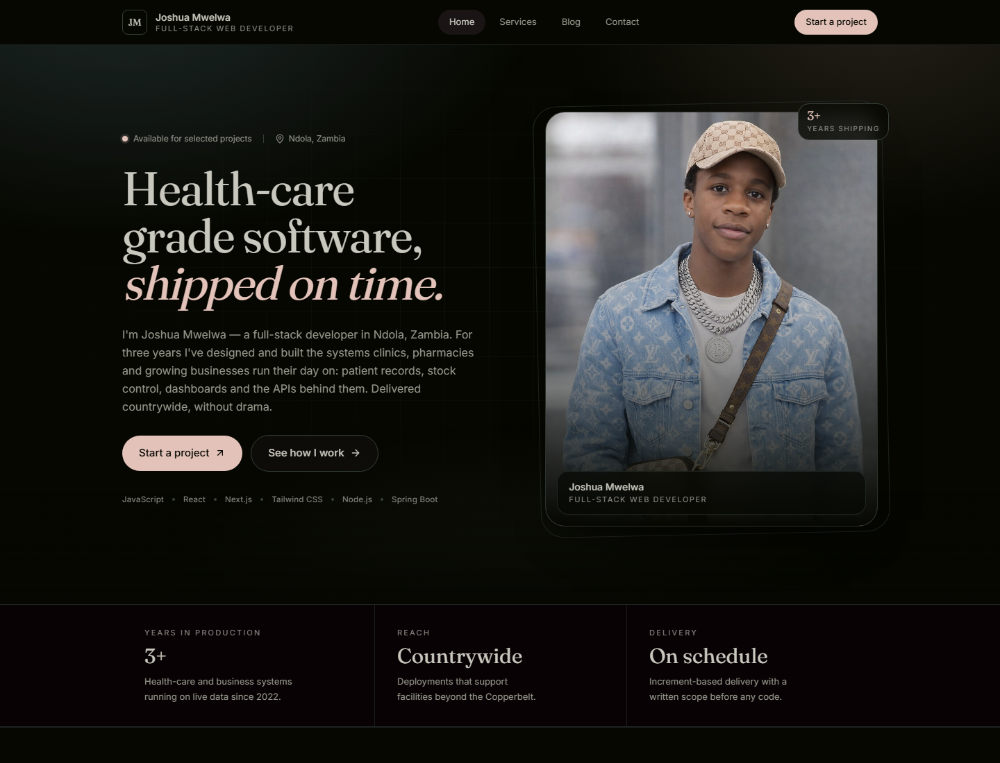
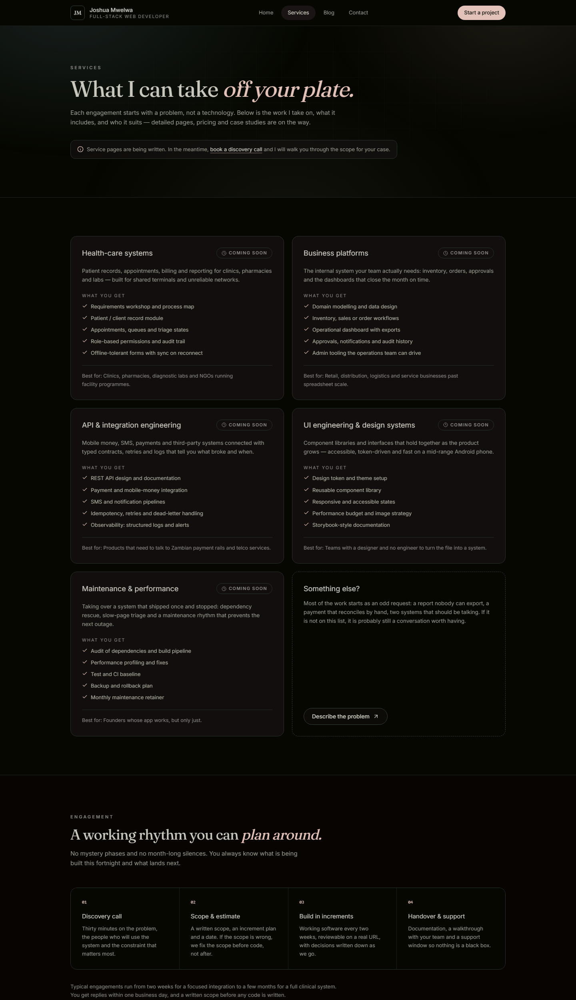
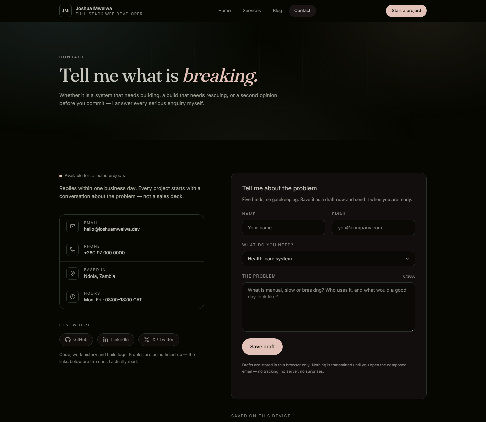
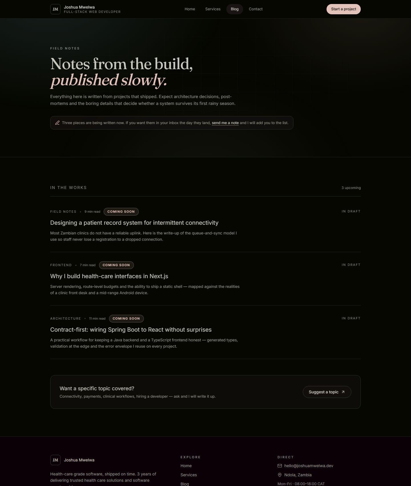

# Joshua Mwelwa — Portfolio

A production-shaped portfolio for a full-stack web developer working out of Ndola, Zambia.
Next.js 16 (App Router) · React 19 · TypeScript (strict) · Tailwind CSS v4.

The site is deliberately **static-first**: it exports to plain files (`out/`) and can be served
from any CDN, including GitHub Pages. No server runtime is required, and no third-party analytics,
fonts or images are fetched at runtime.

---

## What is in here

| Route       | Purpose                                                                   |
| ----------- | ------------------------------------------------------------------------- |
| `/`         | Hero introduction, what I build, the stack, working principles, writing   |
| `/services` | Service catalogue with _coming soon_ detail pages and an engagement model |
| `/blog`     | Writing pipeline with upcoming posts and a topic request form             |
| `/contact`  | Contact channels plus a working **CRUD** message composer                 |

Also generated: `sitemap.xml`, `robots.txt`, a favicon (`icon.svg`), per-route metadata,
Open Graph/Twitter tags and `Person` JSON-LD.

### Screenshots

| Home                                   | Services                                   |
| -------------------------------------- | ------------------------------------------ |
|  |  |

| Contact (CRUD composer)                  | Blog                               |
| ---------------------------------------- | ---------------------------------- |
|  |  |

---

## Quick start

```bash
# Node 20.9+ is required
pnpm install
pnpm dev          # http://localhost:3000

pnpm build        # static export into ./out
pnpm verify       # typecheck + lint + build (the pre-merge bar)
```

| Script         | What it does                                      |
| -------------- | ------------------------------------------------- |
| `dev`          | Next dev server with fast refresh                 |
| `build`        | Production build, emits the static site to `out/` |
| `preview`      | Serves the exported `out/` folder locally          |
| `lint`         | ESLint (flat config, Next core-web-vitals + TS)   |
| `typecheck`    | `tsc --noEmit` against the strict config          |
| `format`       | Prettier, including Tailwind class sorting        |
| `format:check` | Prettier in CI mode                               |
| `verify`       | `typecheck` → `lint` → `build`                    |

Preview the exported build locally:

```bash
npx serve out
```

---

## Tech stack

| Layer     | Choice                                 | Why                                                              |
| --------- | -------------------------------------- | ---------------------------------------------------------------- |
| Framework | **Next.js 16** (App Router)            | Server components by default, static export, file-based routing  |
| UI        | **React 19**                           | Islands of interactivity only where state is genuinely needed    |
| Language  | **TypeScript** (strict)                | `noUncheckedIndexedAccess`, no implicit `any`, exhaustive unions |
| Styling   | **Tailwind CSS v4**                    | Tokens live in CSS via `@theme`; no config drift                 |
| Fonts     | **next/font** (Inter, Fraunces)        | Self-hosted, no layout shift, no external request                |
| Icons     | **lucide-react** + **react-icons**     | Tree-shaken SVG, no sprite files or image icons                  |
| Motion    | CSS transitions + IntersectionObserver | Content is visible without JS; only below-fold blocks animate    |
| Utilities | **clsx** + **tailwind-merge**          | Conflict-free conditional class composition                      |

---

## Design system

The palette is sampled directly from a supplied nine-colour swatch: charcoal and moss base,
a sage→bone text ramp, and exactly one warm accent (dusty rose). Full detail, contrast ratios
and component rules live in [docs/DESIGN-SYSTEM.md](docs/DESIGN-SYSTEM.md).

| Token                  | Hex                   | Role                                     |
| ---------------------- | --------------------- | ---------------------------------------- |
| `canvas`               | `#060701`             | Page background                          |
| `canvas-soft`          | `#0B0006`             | Alternating section bands                |
| `surface`              | `#1A1415`             | Cards and elevated panels                |
| `surface-raised`       | `#212D2D`             | Hover states, ambient glow               |
| `line` / `line-strong` | `#2A322D` / `#363F3A` | Hairlines                                |
| `sage` … `bone`        | `#667268` → `#C9C8BF` | Muted → primary text                     |
| `rose`                 | `#E2C2B9`             | The only accent: links, focus ring, CTAs |

Type is a deliberate pairing: **Fraunces** (serif, display) for headlines, **Inter** for UI and body.
Every interactive element has a visible `:focus-visible` ring in `rose`, and motion collapses when
the visitor prefers reduced motion.

---

## Architecture

```
src/
├─ app/                      # Routes (server components)
│  ├─ layout.tsx             # Fonts, metadata, header/footer, JSON-LD, grain overlay
│  ├─ page.tsx               # Home
│  ├─ services/page.tsx
│  ├─ blog/page.tsx
│  ├─ contact/page.tsx
│  ├─ not-found.tsx
│  ├─ sitemap.ts / robots.ts
│  ├─ icon.svg
│  └─ globals.css            # Tailwind import + design tokens (@theme) + primitives
├─ content/                  # All copy and data — no strings buried in components
│  ├─ site.ts                # Identity, contact, social links (single source of truth)
│  ├─ navigation.ts          # Nav items + primary CTA
│  ├─ capabilities.ts        # "What I build" cards
│  ├─ stack.ts               # Tools + the reason each one is used
│  ├─ principles.ts          # Working commitments
│  ├─ services.ts            # Service catalogue + engagement steps
│  ├─ posts.ts               # Writing pipeline
│  └─ stats.ts               # Proof strip
├─ components/
│  ├─ layout/                # Header (client island), footer
│  ├─ home/                  # Hero, proof strip, capabilities, stack, principles, CTA
│  ├─ services/ blog/ contact/
│  └─ ui/                    # Button, Badge, Section, SectionHeading, PageHeader, Reveal…
└─ lib/
   ├─ cn.ts                  # clsx + tailwind-merge
   ├─ seo.ts                 # One metadata builder for every route
   └─ messages/              # Contact CRUD domain (see below)
```

### The contact module (CRUD)

The contact page is a real CRUD surface, not a decorative form:

```
components/contact/contact-board.tsx   client orchestration (create / edit / delete / clear)
        ├─ message-form.tsx            presentational form, field-level errors
        └─ draft-list.tsx              read view + edit / email / delete actions
lib/messages/
        ├─ types.ts                    Message, MessageInput, ProjectType, MessageStatus
        ├─ validation.ts               pure validate/normalise functions (unit-testable)
        ├─ repository.ts               MessageRepository interface (the seam)
        ├─ local-repository.ts         localStorage implementation, defensive parsing
        ├─ compose.ts                  builds the mailto: payload
        └─ use-messages.ts             React binding: hydration + cross-tab sync
```

**Why a repository?** The site has no API, so records persist in `localStorage` and are
"sent" by composing a `mailto:` — nothing is transmitted silently. When a backend exists,
implement `MessageRepository` against `fetch()` and inject it; `useMessages` and every
component stay untouched. That is the difference between a demo and a seam you can build on.

Validation is a pure function, so it can be unit-tested without a DOM, and the same rules
guard both the form and the repository.

### Rendering strategy

- **Server components by default.** Only five files ship JS that needs a browser:
  the header (routing + drawer), the reveal primitive (motion), and the two contact
  components (local storage).
- **No data fetching at runtime.** Content is imported from `src/content/*` at build time,
  so every route prerenders to static HTML.
- **Zero layout shift.** Fonts are self-hosted with `next/font`, the portrait declares
  intrinsic dimensions, and there are no runtime-loaded images.

---

## Editing content

| Change               | File                                      |
| -------------------- | ----------------------------------------- |
| Name, email, socials | `src/content/site.ts` (look for `TODO`)   |
| Nav + CTA            | `src/content/navigation.ts`               |
| Services             | `src/content/services.ts`                 |
| Blog posts           | `src/content/posts.ts`                    |
| Stack / capabilities | `src/content/stack.ts`, `capabilities.ts` |
| Colours / type       | `src/app/globals.css` (`@theme`)          |

Social links and the email address are **placeholders**. Replace the `TODO` values in
`src/content/site.ts` — header, footer, contact page, sitemap and JSON-LD update from there.

---

## Deployment (GitHub Pages)

`.github/workflows/deploy.yml` builds the site on every push to `main` and publishes `out/`:

1. `actions/setup-node` + `pnpm install --frozen-lockfile`
2. `pnpm build` (static export)
3. `actions/upload-pages-artifact` → `actions/deploy-pages`

If the site lives at `https://<user>.github.io/<repo>/` rather than a custom domain, set
`basePath` and `assetPrefix` in `next.config.ts` to `/<repo>` — otherwise assets resolve
from the domain root.

---

## Quality bar

- `pnpm verify` must pass: strict types, ESLint, and a production build.
- Every interactive element is keyboard reachable with a visible focus ring.
- Contrast is checked against the darkest surface, not the average one. The lowest _text_ pair
  on the site is `stone` on `canvas` at 5.95:1; `sage` (4.02:1) is reserved for icons and rules
  and never carries words.
- No dead links: unfinished areas are labelled _coming soon_ instead of pointing nowhere.
- The contact CRUD was verified in a real browser (headless Chrome probe: create → edit → delete,
  asserting the stored records and the rendered state at each step).
- Accessibility: skip link, landmarks, `aria-live` for form status, labelled controls,
  `prefers-reduced-motion` support.

---

## Roadmap

- [ ] Real service detail pages with scope and pricing
- [ ] Blog rendered from MDX with RSS and per-post OG images
- [ ] `POST /api/messages` implementing `MessageRepository` + email delivery
- [ ] Case studies with before/after metrics
- [ ] Unit tests for `lib/messages` (validation + repository) with Vitest
- [ ] Lighthouse budget enforced in CI

---

## Legacy

The previous single-file profile card lives in [`legacy/profile-card/`](legacy/profile-card/) for
reference. It is excluded from the build.

---

## License

MIT © Joshua Mwelwa. Copy the structure, replace the words.
